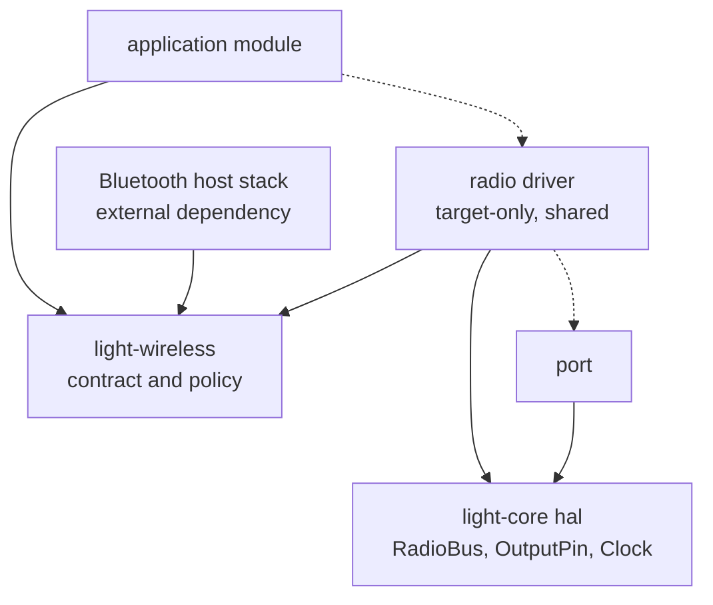

# Wireless — `light-wireless` and radio drivers

Radio hardware: joining a wireless network, and the short-range radio that the same part usually
carries. This document covers everything up to and including the bytes that cross to the radio's
controller. It does **not** cover the network stack above a joined network — addresses, sockets,
transfers — which is its own subsystem; nor the Bluetooth *host* stack above the controller
interface, which is a dependency rather than something the framework writes.

---

## Responsibility

`light-wireless` is the portable contract for a radio: what a set of credentials is, what was heard
during a scan, what the outcomes of joining are, and the seams a driver implements. It contains no
hardware and no vendor, runs under `cargo test`, and holds the policy that would otherwise be
rewritten — and got wrong — once per port.

A **radio driver** crate sits below it: target-only, shared between chips rather than owned by one,
and responsible for a specific part. It reaches the world through one bus seam, so the chip it runs
on contributes a bus and nothing else.

A **port** contributes that bus, the power line, and the clock. That is the whole of what adding a
new chip to this subsystem costs.

*Solid arrows are compile-time dependencies, dashed are runtime calls. The driver depends on the
contract and on the port interface, never on a port; the application chooses which driver it links.*

## The crates

    light-wireless      portable, host-tested: credentials, scan results, join outcomes,
                        the WifiRadio / BluetoothController / HciTransport seams
    a radio driver      target-only, shared: one part, over the RadioBus seam
    a port              the bus, the power line, the clock

## Public surface

In `light_core::hal`:

- **`RadioBus`** — a word-oriented, half-duplex, single-wire bus: the host clocks a command out on
  the data line, turns the line around, and clocks the answer back in on the same wire. Blocking.
  `write(&[u32]) -> u32` sends a command and returns the status word; `read(u32, &mut [u32]) -> u32`
  sends a command word and fills the response; `ready()` reports whether the part has something to
  say, defaulting to "always", which yields polling.

In `light-wireless`:

- **`Credentials`** — a network name and an optional passphrase, constructed only if both are
  lengths the protocol permits. The one place those limits live.
- **`Security`** — what a network offers: none, the older key exchange, the newer one, or both.
- **`ScanEntry`** — one radio heard: its name (empty when withheld), the address that sent the
  beacon, the signal of that sighting, and the channel.
- **`Sightings<N>`** — accumulates entries during a sweep and suppresses repeats by sending address.
- **`JoinError`** — why a network was not joined, in terms an operator can act on: not found, no
  answer, refused, already attempted, or credentials that were never sent.
- **`WifiRadio`** — bring the radio up, read its address, join, scan, drive a general-purpose pin.
- **`BluetoothController`** — bring the short-range controller up and read its address.
- **`HciTransport`** — the byte interface a Bluetooth host stack sits on: hand a packet down, take a
  packet up. The framework implements this seam and consumes a host stack above it; it does not
  write the host stack.

## Behaviour and invariants

- **The radio holds no firmware of its own.** It is powered, handed its image over the bus, and only
  then is it a radio. The image is delivered as an **asset**, not linked into the executable: it is a
  quarter of a megabyte, it is identical across both slots of an update pair, and linking it would
  put it in every slot and re-sign it whenever anything else changed. See
  [11-secure-boot-and-update.md](11-secure-boot-and-update.md) for how the pack's digest protects it.
- **Both radios are one part: one bus, one power line, one upload.** The short-range side is
  **additive, never an alternative** — asking for it adds a second image beside the first and changes
  nothing about the wireless side. A part that answers on one and not the other is reported and
  carried on with, because the wireless side is what a board depends on first.
- **The module's own calibration and identity travel with the image, and must match the part.** They
  describe the radio's board — what its antenna looks like, the power it may raise. Nothing checks
  that the settings and the silicon agree, and the failure is among the least diagnosable there is:
  reception needs no calibration and transmission does, so the radio comes up, reports its address,
  hears every network in the building, associates — and is then disconnected when the keys are
  exchanged. Confirm the settings against the part the radio reports itself to be, not against the
  name of the board it is soldered to.
- **Credentials are checked before the hardware is asked.** A driver is entitled to treat a command
  the radio refuses as fatal, and a value outside the protocol's limits is refused outright — so a
  mistyped passphrase, the most ordinary mistake there is, must not reach the part. Checking early
  also means the attempt below is unspent, so a correction can simply be retyped.
- **A radio is joined once per power-up.** Joining issues commands the part accepts only while its
  interface is down, and letting go of a network does not bring it down. A second attempt is refused
  with an error that says so, rather than attempted and fatal. It is the *attempt* that counts, not
  the outcome: a join that fails has brought the interface up just the same.
- **A scan reports one entry per radio, not one per beacon.** A sweep revisits each channel, so a
  radio answers several times with a different signal each time. Entries are kept apart by the
  address that sent the beacon rather than by the name, because several radios serving one name is
  the ordinary shape of a network covering a building and one radio answering twice is not. The
  sending address is reported for the same reason: without it those entries read as a mistake.
- **The signal in an entry is one sighting, not a measurement.** Successive beacons from one place
  differ by several decibels. It answers "is this in range", not "which is stronger".
- **The accumulator is bounded, and overflows into repeats rather than omissions.** Past its capacity
  nothing further can be remembered, so repeats reappear. That is the better failure: a long list
  with repeats still says what is in range, where dropping the overflow would claim a network is
  absent.
- **Every future is polled once per runtime pass.** Radio stacks are written for an executor and this
  framework has none. A driver polls its own futures from the module poll that owns it, and a
  blocking errand runs a nested loop with a deadline. There is no second scheduler, and nothing in
  this subsystem may block without one.
- **A driver's own account of itself is relayed into the framework's log**, capped below its
  per-transfer level. A radio that refuses reports the reason there and nowhere else, so discarding
  it turns every bring-up into guesswork.
- **Reports name the causes an operator can act on, in order of likelihood.** A refusal that blames
  only the passphrase is actively misleading when the network's protection is the real cause; both
  are named, because from above the two are indistinguishable and the passphrase is what everybody
  checks first.

## Notable design decisions and constraints

- **The bus seam is blocking and word-oriented, and that is what keeps the vendor out of
  `light-core`.** Radio drivers in this ecosystem want an asynchronous bus, but such a bus is
  blocking underneath — it waits on a FIFO — so the seam is declared blocking and the driver crate
  adapts it upward. Declaring it asynchronously instead would put a specific driver's shape, and its
  executor's futures, into the port interface that every other subsystem shares.
- **The driver is a shared target-only crate, not a module inside a port.** A radio part outlives the
  chip it is wired to: the same module appears beside several. Putting the driver in a port means the
  next chip copies it, and the copies diverge. Only what is genuinely the chip's — the bus, the power
  line, the clock — stays in the port.
- **The credential rules are portable and host-tested, and that is the point of the crate.** Split
  across an application and a port, they were each locally complete and jointly wrong: one bounded
  the name and the passphrase's maximum, the other the passphrase's minimum, and neither author could
  see the gap. A single type with the limits in it, exercised on the host, removes that class of
  defect rather than fixing an instance of it.
- **The subsystem ends at the controller interface.** Above it, a Bluetooth host stack is a
  dependency the framework consumes through `HciTransport`, not something it writes: advertising,
  connections and attribute protocols are a large, well-served body of work, and reimplementing them
  would be a second framework inside this one.
- **The network stack stays with the driver until it has its own subsystem.** Sockets and transfers
  are bound to the driver's packet interface, so they travel with it rather than being stranded in a
  port. Lifting them out is the network subsystem's first task, and the seam it will cut is the
  packet interface the driver already exposes.
- **The transport carries no trust.** There is no transport security. What arrives over a radio is
  either signed and verified by the hardware that runs it, or it is data an application validates
  itself. See [11-secure-boot-and-update.md](11-secure-boot-and-update.md).
- **Some networks a part simply cannot join, and that is a property to record rather than a bug to
  chase.** A part whose key exchange is implemented in its own firmware supports what that firmware
  supports. Where a network offers both the older and the newer protection, a part may offer the
  newer one, be refused, and have no way to withdraw the offer — failing at a different stage in each
  mode, and in both cases looking exactly like a wrong passphrase. The reference part's limits are in
  [07-ports-and-shell.md](07-ports-and-shell.md).

### Reference implementation

The reference driver is for a combined part carrying both radios behind one half-duplex serial bus,
as fitted to several boards of the RP2 family; its bus is built from that chip's programmable I/O
because no SPI peripheral turns a single data line around mid-transfer. Both are described, with
their part- and chip-specific facts, in [07-ports-and-shell.md](07-ports-and-shell.md).
