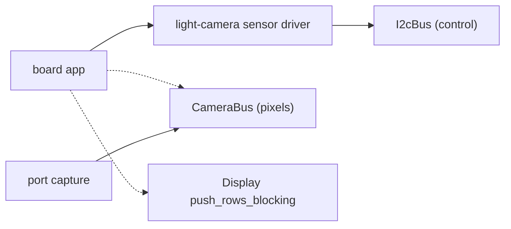

# Camera — `light-camera`

This document describes how an image sensor's frames reach memory and the panel. Three pieces share
the work. `light-camera` holds the sensor drivers, which configure the sensor over its control bus.
The `CameraBus` HAL trait carries the pixels: a port realises the sensor's parallel pixel bus behind
it. The display core's `push_rows_blocking` puts a landed frame on a panel without the frame passing
through the display's own buffers. Like every portable crate, `light-camera` reaches hardware only
through `light_core::hal` traits, so a driver runs under `cargo test` against a mocked bus.

*The driver configures the sensor; the port's capture lands frames; the app hands each frame to the display.*

---

## Responsibility

- Configure an image sensor for a stream the port can capture: output size, pixel format, and the
  sensor's PLL, with the pixel clock that PLL gives.
- Keep the **byte order** of the stream equal to the order a display bus sends. A captured RGB565
  frame is then pushed as it stands, with no swap on the CPU and no swap in the capture.
- Leave to the board what is the board's: the sensor's master clock, its power-down line, how the
  module is mounted (mirror and flip), and which PLL settings suit the master clock the board feeds.

## Public surface

- **`CameraBus`** (in `light_core::hal`): the port's pixel bus.
  - `unsafe start_frame(buf)` arms the capture of the next whole frame into `buf`. Capture starts at
    the next frame start, never part-way through a frame already under way. `buf` is word-aligned and
    a multiple of 4 bytes long, and the caller leaves it alone until the frame lands.
  - `frame_complete` reports whether the armed frame has fully landed.
  - `stop` abandons an armed capture.
- **`CameraError`**: `Bus(I2cError)`, `WrongChip(id)`, `Unsupported`.
- **`Ov5640<B: I2cBus>`**, the reference sensor driver:
  - `chip_id`, `read`;
  - `init(clock, width, height, pll)`, blocking, init only;
  - `set_test_pattern(on)`, the sensor's colour bars;
  - `set_orientation(mirror, flip)`.
- **`Pll`**: the sensor's PLL in register terms. These are `multiplier`, `sys_div`, `pre_div`,
  `root_2x`, `pclk_root_div` and `pclk_div`.
- **`Display::push_rows_blocking(buf, y0, rows)`** (in `light-display`): pushes full-width rows from
  a buffer the display does not own, and blocks until they have landed.

## Behaviour and invariants

- **Every frame re-synchronises.** Arming a frame starts capture at the sensor's next frame-start
  edge, and counts that frame's bytes from there. A lost or extra pixel-clock edge can spoil one frame
  but never shift the next. A capture that counts bytes across frames from a single synchronisation
  rolls every later image after one missed edge.
- **The buffer is word-aligned.** A capture lands its frame in word writes. A misaligned buffer is not
  an error the transfer engine reports: it runs, busy and advancing, and the buffer is left as it
  was. So a port refuses a misaligned buffer outright.
- **Bytes land in arrival order.** The sensor sends RGB565 high byte first, which is the order a
  display bus sends. The capture packs bytes into words so that memory order equals arrival order.
- **The sensor needs its master clock to answer.** A driver's first register access, the chip-id
  probe included, comes after the board has started the clock and released power-down.
- **The pixel clock is bounded twice.** It must carry a line's bytes within the sensor's line time,
  or the sensor's output FIFO overruns. It must also stay within what the port's capture keeps up
  with. The board picks the `Pll` against both.
- **`push_rows_blocking` leaves the display's buffers alone.** On a banded display, or any panel that
  keeps its own frame, the pushed image stays on the glass until something paints over it. A preview
  therefore pauses the interface's rendering while it runs, and invalidates the whole interface when
  it stops.

## The OV5640 reference driver

- 16-bit register addresses over SCCB at 0x3C. The chip id is 0x5640.
- `init` works in a fixed order:
  1. software reset;
  2. the tuning table (AEC/AGC, AWB, colour matrix, gamma, sharpness), taken as a block;
  3. the output window;
  4. binning;
  5. the PLL;
  6. RGB565 high byte first (`0x4300 = 0x61`).
- Only the binned 4:3 path is configured. The whole sensor is read 2x2-binned to 1312x976 and scaled
  by the ISP to the requested size. This covers every preview size up to 1280x960; larger sizes are
  `Unsupported`.
- VSYNC is low only during its sync pulse. A frame starts on its rising edge, and HREF gates the bytes
  of each line.

## Design decisions and constraints

- **A single frame buffer serves a preview.** Capture lands a frame, the display pushes it, and only
  then is the next frame armed. One buffer is never written and read at once, so the preview shows
  every other sensor frame. On a board with room for a second frame, alternating two buffers would
  overlap the push with the next capture.
- **The capture is the port's, and so is its timing budget.** How fast a pixel clock a port keeps
  up with depends on its capture hardware and its system clock. The figure for each port is in
  [07-ports-and-shell.md](07-ports-and-shell.md).
- **The PLL is a parameter, not a table in the driver.** The right values depend on the master clock
  the board feeds, so the board crate holds them beside that clock.
