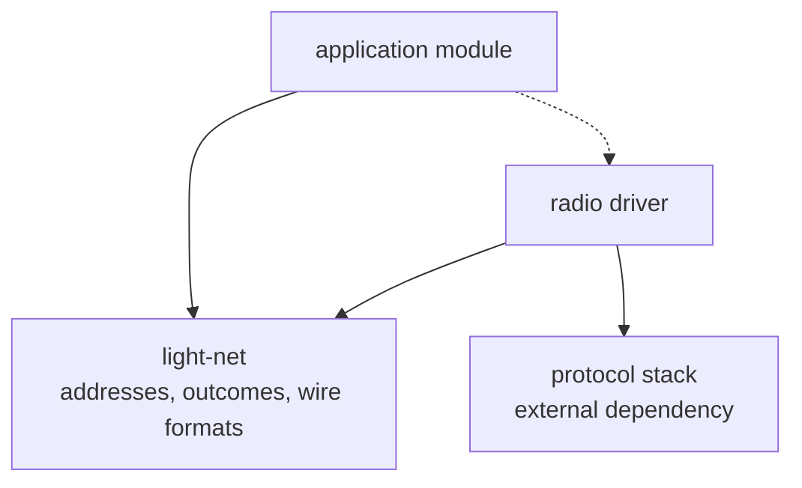

# Network — `light-net`

What a device does once it is on a network: take an address, open a connection, and fetch something
over it. This document covers the part of that the framework owns. It does **not** cover getting onto
a network, which is [12-wireless.md](12-wireless.md).

---

## Responsibility

`light-net` is the portable part of networking: the shape of an address a network handed out, the
outcomes a transfer can have, and **the wire formats** — building a request and reading a response.
It contains no hardware, no sockets and no asynchrony, runs under `cargo test`, and is where the
logic lives that is worth being wrong about only once.

Two things are deliberately **not** in it:

- **The protocol stack is a dependency, not something the framework writes.** Addressing, routing
  and connections over the packet interface a radio exposes are a large, well-served body of work.
  The framework consumes such a stack exactly as it consumes a Bluetooth host stack above
  `HciTransport`.
- **The socket plumbing belongs to whatever owns the packet interface** — in practice a radio
  driver, because a stack is built on that driver's device handle and cannot be separated from it.
  A driver holds the stack, does the reads and writes, and uses this crate for everything above the
  bytes.

*Solid arrows are compile-time dependencies, dashed are runtime calls. The driver owns the stack and
the sockets; what it takes from `light-net` is the format of what goes over them.*

## Public surface

- **`Config`** — what a network gave: an address, its prefix length, and the way out if one was
  offered. A network that offers no way out reaches its own hosts and nothing beyond, which is a
  transfer that fails later for a reason nobody would look for here, so it is worth reporting at the
  moment it is learned.
- **`NetError`** — why there is no address.
- **`Incoming`** — what a transfer hands out as it learns it: the body's **length first, once, before
  any of it**, then pieces of the body in arrival order, kept nowhere afterwards.
- **`FetchError`** — the outcomes of a transfer, each distinguishing something a caller would act on
  differently: no network, no connection, a connection that broke part-way, an answer that was not
  one, a **refusal carrying the server's own code**, an answer that did not say how long it was, a
  body shorter than promised, a receiver that would not take it, and running out of time.
- **`get_request`** — formats a request for a path at an address into a caller's buffer.
- **`read_head`** — offered everything received so far, reports whether the response head is
  complete and, when it is, the status, the declared length and where the body begins.

## Behaviour and invariants

- **A transfer is handed to a sink as it arrives and is never held whole.** What is being fetched may
  be far larger than the memory available; each piece goes from the network to its destination and is
  not kept. This is a contract, not an optimisation, and it is why the length comes first.
- **The length is required, not merely read.** Without it there is no telling a truncated transfer
  from a complete one, and a destination that must be prepared to a size — storage erased to fit —
  cannot be prepared at all. A server that does not say is refused rather than trusted.
- **A response head may arrive in any number of pieces, and the body may arrive with it.** Reading
  the head is therefore incremental and reports where the body starts, so the bytes that came early
  are not lost. A head longer than the room allowed is an answer that cannot be used, not a reason
  to keep reading.
- **A header name is matched without regard to case**, because the standard allows any and servers
  use several.
- **An address is given, never a name.** Resolving a name means another service to depend on at
  exactly the moment a device may be trying to repair itself, and one more thing that can be wrong
  when the thing being fixed is the network. An address in a command is a smaller promise than a name
  in a configuration.
- **There is no transport security.** What arrives is either signed and verified by the hardware that
  will run it, or it is data the application validates itself. See
  [11-secure-boot-and-update.md](11-secure-boot-and-update.md).
- **A transfer that runs out of time reports how far it got.** How many bytes of how many, because
  "too slow" alone cannot tell a link that carried almost everything from one that carried nothing,
  and those want opposite responses. The measured behaviour behind this is in
  [11-secure-boot-and-update.md](11-secure-boot-and-update.md).

## Notable design decisions and constraints

- **The wire formats are separated from the socket, and that is the whole reason this crate exists.**
  Parsing a status line, finding the end of a head that arrived in three pieces, reading a length
  whose header name is spelled differently by different servers — this is where the defects are, and
  none of it needs a network to test. Held inside a driver it could only be exercised by pointing a
  board at a server; held here it is exercised by `cargo test` against the awkward inputs a real
  server rarely produces on demand.
- **Nothing here is asynchronous, and it holds no state machine of its own.** The caller owns the
  reading and writing and offers this crate the bytes; it answers about them. That suits a framework
  whose concurrency model is a cooperative poll, and it keeps the crate free of the executor and
  futures the stack below a driver brings with it.
- **The stack's buffers are the driver's, sized by the driver.** They are large — tens of kilobytes —
  and their size is a property of the link and the destination rather than of the protocol, so they
  belong beside the hardware that determines them, in `.bss` and never on a stack.
